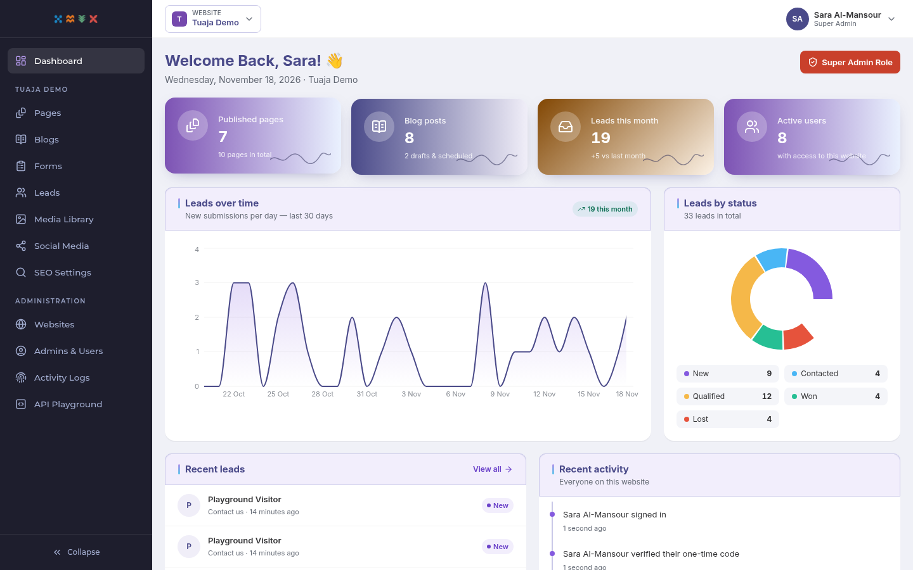
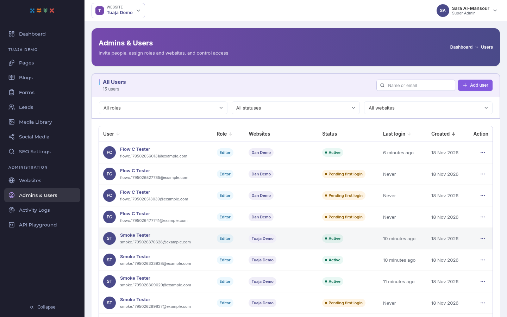
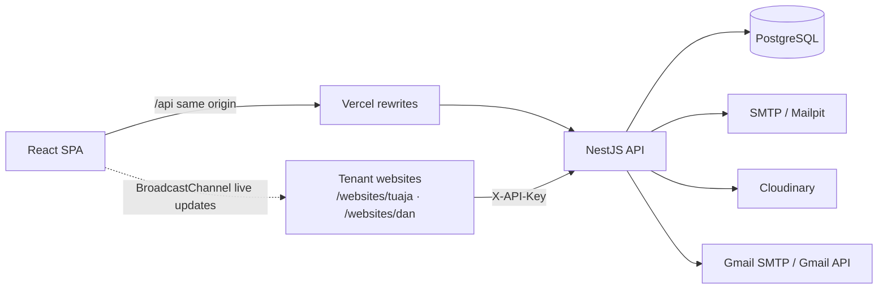
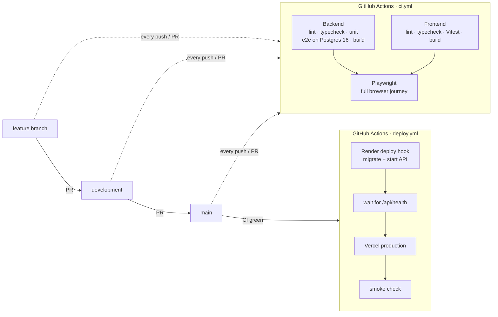

# PIF Admin Panel

[](https://github.com/RohabAmir/PIF-AdminPanel-MVP/actions/workflows/ci.yml)
[](https://github.com/RohabAmir/PIF-AdminPanel-MVP/actions/workflows/deploy.yml)


A production-grade, **multi-tenant CMS admin panel**: one dashboard to manage the pages, typed content blocks, blogs, forms, leads, SEO, media and social links of **any number of websites** — with two-factor login, role-based access, per-website isolation, a public content API and a complete audit trail.



## Highlights

- 🔐 **Secure authentication** — password + emailed 6-digit OTP, forced password change on first login, forgot/reset by single-use link, account lockout, rotating refresh tokens with **theft (reuse) detection**, access token kept in memory only, cross-tab logout.
- 🧑‍🤝‍🧑 **RBAC** — Super Admin / Admin / Editor / Viewer, enforced by API guards and mirrored in the UI ([matrix](docs/RBAC.md)).
- 🏢 **Multi-tenancy** — shared schema with `siteId` everywhere, enforced centrally by a Prisma extension; create a new website from the UI and manage it instantly — zero code changes.
- 🧱 **CMS** — pages with drag-and-drop **typed sections** (hero, rich text, image & text, feature cards, stats, testimonials, FAQ, CTA, gallery) with live preview + JSON view; **Tiptap** blogs with categories, tags, scheduling and reading time; form builder; leads with notes, statuses and CSV export; media library; social links; global + per-page **SEO with Google preview**.
- 🖥️ **Live tenant websites** — pixel-faithful replicas of **tuaja.com** and **dancompany.sa** at `/websites/tuaja` and `/websites/dan`, rendered entirely from the CMS. Edit, add, hide, delete or drag a section and every open website tab (and the editor's built-in **Website preview**) updates instantly — no reload, no deploy.
- 📧 **Real email via Gmail** — welcome emails (with temporary password) and sign-in codes land in real Gmail inboxes, via Gmail SMTP + app password or the Gmail API over HTTPS.
- 🌐 **Public content API** — API-key authenticated, CORS-open, cached; form submissions create leads (honeypot + rate limit). Try it in the built-in **API Playground** or the static `demo-site.html`.
- 📜 **Activity logs** — every mutating action with actor, role at the time, website, before/after diff, IP, user agent and request id; filters + CSV export; append-only.
- ✅ **Quality** — TypeScript strict, 34 backend unit + 66 backend e2e tests (real Postgres), 21 frontend tests, 4 Playwright browser tests (incl. live website updates), ESLint/Prettier, Husky, CI/CD with GitHub Actions → Render + Vercel.

## Screenshots

| Sign in                              | Two-step verification            |
| ------------------------------------ | -------------------------------- |
|  |  |

| Page editor — typed sections, live preview       | Blog editor — Tiptap                             |
| ------------------------------------------------ | ------------------------------------------------ |
|  |  |

| Leads                                | Activity logs with diffs                             |
| ------------------------------------ | ---------------------------------------------------- |
|  |  |

| Users & roles                        | Mobile                                                                |
| ------------------------------------ | --------------------------------------------------------------------- |
|  |  |

## Demo logins

All demo accounts share the password **`Demo@12345`**. Each sign-in emails a one-time code (locally visible in Mailpit at http://localhost:8025; on the hosted demo it is shown on screen).

| Role        | Email                    | Websites             |
| ----------- | ------------------------ | -------------------- |
| Super Admin | `superadmin@pifdemo.com` | all                  |
| Admin       | `admin@pifdemo.com`      | Tuaja Demo, Dan Demo |
| Editor      | `editor@pifdemo.com`     | Tuaja Demo           |
| Viewer      | `viewer@pifdemo.com`     | Dan Demo             |

Public API demo keys: Tuaja Demo `pif_tuajadem_PublicDemoKey-TuajaDemo-2026` · Dan Demo `pif_dandemo1_PublicDemoKey-DanDemo-2026xx`.

## Tenant websites (Tuaja & Dan)

The two demo tenants each have a hosted website that replicates the real site's layout, typography, colours and imagery — and reads **every word and image from the CMS** through the public content API with its own API key, exactly as the production sites would.

| Website | URL               | Tenant in the dashboard | Built from                                                                                        |
| ------- | ----------------- | ----------------------- | ------------------------------------------------------------------------------------------------- |
| Tuaja   | `/websites/tuaja` | Tuaja Demo              | video hero, Al-Ahsa intro with resort buttons, experience cards, story, community, collage, press |
| Dan     | `/websites/dan`   | Dan Demo                | "Let Nature Be" video hero, About Dan, tourism tiles, partner marquee, media center               |

**Demo flow**

1. Sign in, pick **Tuaja Demo** or **Dan Demo** in the website switcher and click **View website** (top bar).
2. Open **Pages → Home**. Edit a section and **Save**, toggle a section's visibility, add a block, or **drag** sections into a new order — the website tab updates within a second (changed sections briefly glow).
3. Or stay in the editor: the **Website preview** tab shows the real page (desktop / mobile) next to the draggable section list.
4. Rename or nest pages (Details → Parent page) and the website navigation follows; publish blog posts and they appear under Press Center / Media Center; submit the website contact form and the lead appears in **Leads**.

How it works: the sites are a lazy-loaded part of the frontend ([frontend/src/websites](frontend/src/websites)) with one theme per brand. Each typed block renders in both themes, so any block added in the dashboard shows up styled. The admin panel announces every successful save on a same-origin `BroadcastChannel`; the websites also refetch on focus and every 20 s (for other devices). Only **published** pages and **visible** sections are shown.

Website blocks added for the replicas: **Image cards** (photo cards with icon, link and accent colour), **Latest posts** (newest blog posts), **Form** (any CMS form, submissions become leads); **Hero** gained body text, background video, overlay artwork and coloured buttons; **Image & text** an intro line, button and light/dark/accent background; **Gallery** grid / collage / logo-strip layouts.

To rebuild the two websites' content from the seed (pages, sections, blogs, media, social, SEO — users, forms, leads and logs are kept):

```bash
npm --prefix backend run db:seed:websites
# hosted database: DATABASE_URL="<production url>" npm --prefix backend run db:seed:websites
```

Images live in `frontend/public/websites/<site>/`; the hero videos are 20-second 720p loops of the originals.

## Email delivery (Gmail)

By default emails go to the local Mailpit inbox. To deliver **welcome emails** (new users get their temporary password) and **sign-in codes** to real Gmail inboxes, pick one provider in `backend/.env`:

**Option A — Gmail SMTP with an app password (simplest)**

1. On the sending Google account enable **2-Step Verification**, then create an **App password** (Google Account → Security → App passwords).
2. Set:
   ```env
   MAIL_PROVIDER=gmail
   GMAIL_USER=your.account@gmail.com
   GMAIL_APP_PASSWORD=abcd efgh ijkl mnop
   MAIL_FROM="PIF Admin Panel <your.account@gmail.com>"
   ```

**Option B — Gmail API over HTTPS (for hosts that block SMTP ports)**

1. In Google Cloud: enable the **Gmail API**, create an **OAuth client (Web)**, add `https://developers.google.com/oauthplayground` as a redirect URI.
2. In the [OAuth Playground](https://developers.google.com/oauthplayground) (⚙ → use your own client), authorise scope `https://www.googleapis.com/auth/gmail.send` as the sending account and exchange for a **refresh token**.
3. Set `MAIL_PROVIDER=gmail-api`, `GMAIL_USER`, `GMAIL_CLIENT_ID`, `GMAIL_CLIENT_SECRET`, `GMAIL_REFRESH_TOKEN`.

Verify either setup — it checks the credentials and sends a real test email:

```bash
npm --prefix backend run mail:test -- someone@gmail.com
```

Then add a user in **Users** with a Gmail address: the welcome email arrives in that inbox, and each sign-in emails a 6-digit code. On the hosted demo, set the same variables in the Render dashboard. (`DEMO_MODE` still shows codes on screen for the four shared demo accounts only.)

## Architecture



Details: [ARCHITECTURE.md](docs/ARCHITECTURE.md) (request lifecycle, tenant isolation, auth sequence, ERD) · [RBAC.md](docs/RBAC.md) · [API.md](docs/API.md) (and Swagger at `/api/docs`) · [CI-CD-GUIDE.md](docs/CI-CD-GUIDE.md) · [DECISIONS.md](docs/DECISIONS.md) · [DESIGN-TOKENS.md](docs/DESIGN-TOKENS.md).

## CI/CD pipeline

Every change goes through the same automated path — nobody deploys from a laptop.



| Stage                                                    | Trigger                                 | What runs                                                                                                                                                                                                           |
| -------------------------------------------------------- | --------------------------------------- | ------------------------------------------------------------------------------------------------------------------------------------------------------------------------------------------------------------------- |
| **CI** ([ci.yml](.github/workflows/ci.yml))              | every push and pull request, any branch | backend lint, typecheck, unit tests, API e2e tests against a real PostgreSQL service container, build · frontend lint, typecheck, Vitest, build · Playwright browser tests on the built app with Postgres + Mailpit |
| **Preview** ([deploy.yml](.github/workflows/deploy.yml)) | pull request into `main`                | Vercel preview deployment, URL commented on the PR                                                                                                                                                                  |
| **CD** ([deploy.yml](.github/workflows/deploy.yml))      | CI succeeds on `main`                   | Render deploy (API + migrations) → health check → Vercel production deploy → smoke check on the live URLs                                                                                                           |
| **Local gate**                                           | every commit                            | Husky + lint-staged run ESLint and Prettier on staged files                                                                                                                                                         |

Branches: work happens on feature branches, is merged into **`development`** for integration, and **`development` → `main`** releases to production. `main` is protected by the CI status checks. Proof of every run — logs, timings, test output, artifacts — is public in the [Actions tab](https://github.com/RohabAmir/PIF-AdminPanel-MVP/actions). Production deploys are switched on with the repository variable `DEPLOY_ENABLED=true`. Full walkthrough: [CI-CD-GUIDE.md](docs/CI-CD-GUIDE.md).

## Tech stack

| Layer              | Tools                                                                                                                                                                                                          |
| ------------------ | -------------------------------------------------------------------------------------------------------------------------------------------------------------------------------------------------------------- |
| Frontend           | React 18, TypeScript (strict), Vite 6, React Router 6 (data router), TanStack Query 5, Axios (refresh interceptor), React Hook Form + Zod, Tailwind CSS 3, Radix UI, Tiptap, Recharts, dnd-kit, Lucide, Sonner |
| Backend            | NestJS 11, Prisma 6, PostgreSQL 16, Passport-JWT, bcrypt, class-validator, Throttler, Helmet, Swagger, Nodemailer + Handlebars, Joi env validation, Pino, Terminus                                             |
| Testing            | Jest + Supertest (e2e on a real database), Vitest + Testing Library, Playwright                                                                                                                                |
| Tooling & delivery | ESLint, Prettier, Husky + lint-staged, GitHub Actions, Dependabot, Render (API + DB), Vercel (web)                                                                                                             |

## Run it locally

Prerequisites: **Node 20.19+** and either **Docker** or nothing else (a Docker-free fallback is included).

```bash
git clone https://github.com/RohabAmir/PIF-AdminPanel-MVP.git
cd PIF-AdminPanel-MVP
npm run setup                       # installs root, backend and frontend

# 1. Infrastructure: PostgreSQL 16 + Mailpit
npm run infra                       # docker compose up -d
#   …or without Docker (embedded Postgres 16 + Mailpit-compatible catcher), in a separate terminal:
#   npm run infra:local

# 2. Configuration
cp backend/.env.example backend/.env           # then set two random JWT secrets:
node -e "console.log(require('crypto').randomBytes(48).toString('base64url'))"
cp backend/.env.test.example backend/.env.test # only needed for the e2e tests
cp frontend/.env.example frontend/.env

# 3. Database
npm run db:setup                    # prisma migrate deploy + idempotent seed

# 4. Start API + web
npm run dev
```

|                   | URL                                  |
| ----------------- | ------------------------------------ |
| Admin panel       | http://localhost:5173                |
| API               | http://localhost:3000/api            |
| Swagger           | http://localhost:3000/api/docs       |
| Mailpit inbox     | http://localhost:8025                |
| Tuaja website     | http://localhost:5173/websites/tuaja |
| Dan website       | http://localhost:5173/websites/dan   |
| Generic demo site | http://localhost:5173/demo-site.html |

### Quality commands

```bash
npm run lint && npm run typecheck && npm run test && npm run build   # both apps
npm --prefix backend run test:e2e                                     # API e2e (uses pif_admin_test)
npx playwright install chromium && npm run e2e                        # browser smoke test (stack running)
```

## Project structure

```
PIF-AdminPanel-MVP/
├── backend/            NestJS API — auth, users, sites, cms/*, public-api, audit, dashboard
│   ├── prisma/         schema, migrations, idempotent seed
│   ├── scripts/        mail:test (verify email delivery)
│   └── test/           e2e suites (auth, users, RBAC & tenancy, CMS & public API)
├── frontend/           React app — auth/, site/, components/{ui,layout,cms}, pages/, websites/ (Tuaja & Dan themes)
│   └── public/websites/ images and hero videos of the hosted websites
├── e2e/                Playwright: smoke journey + websites (render, live edits, drag & drop, form → lead)
├── docs/               architecture, RBAC, API, CI/CD guide, decisions, design tokens, screenshots
├── scripts/            timelog, Docker-free local infra
├── .github/workflows/  ci.yml, deploy.yml, keep-alive.yml
├── docker-compose.yml  render.yaml  frontend/vercel.json
└── TIME_REPORT.md      real build time per phase
```

---

Built by Rohab Amir. **Demo project.** Website copy, imagery and press releases of Tuaja and Dan are reproduced from tuaja.com and dancompany.sa for the client demo at the project owner's request; users, leads and activity logs are fictional. Logo, backgrounds and palette of the dashboard are reused from the original dashboard at the project owner's request. MIT licensed.
