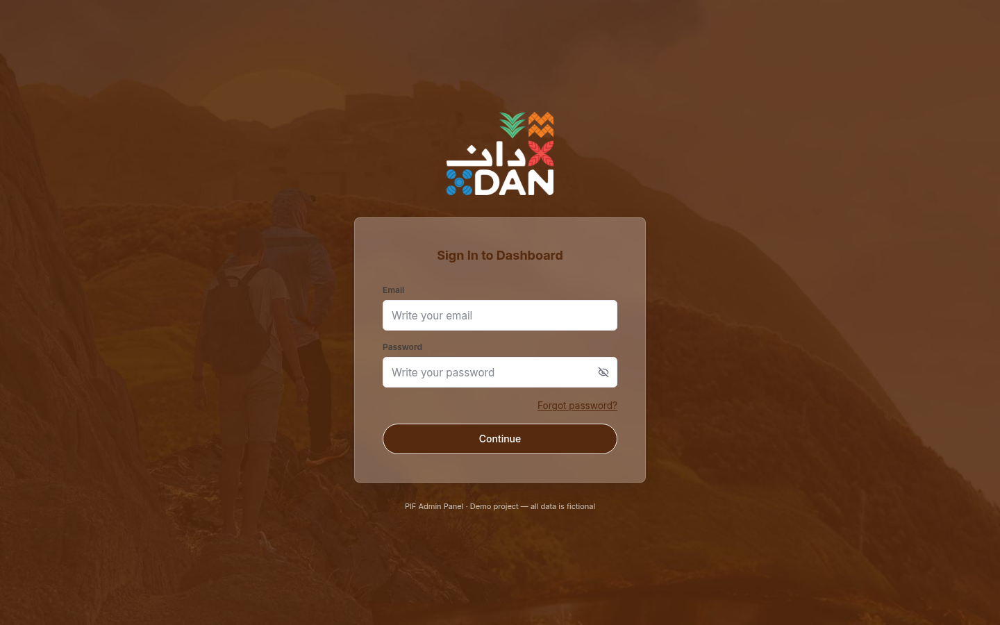
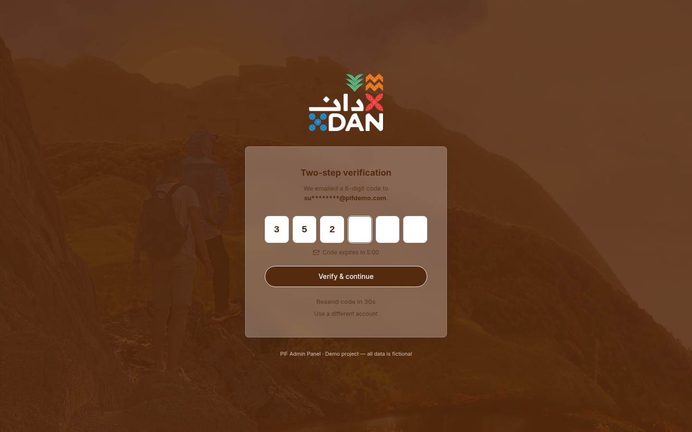
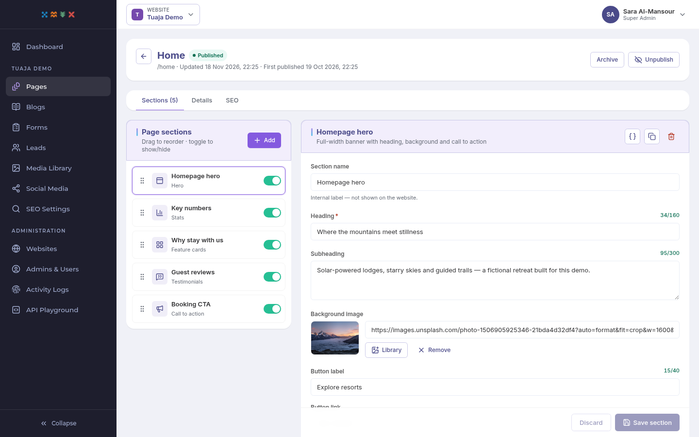
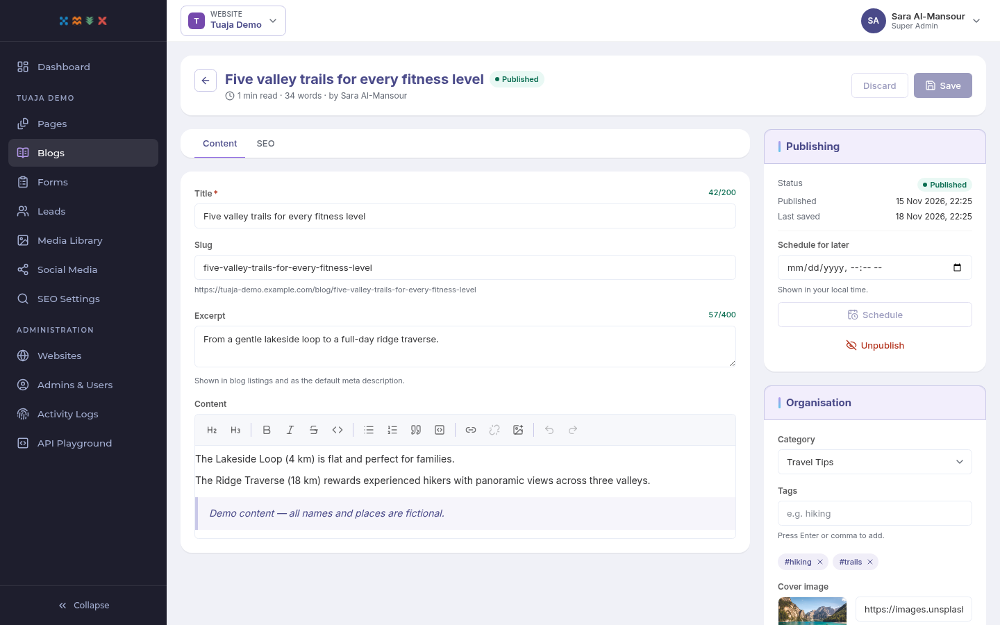
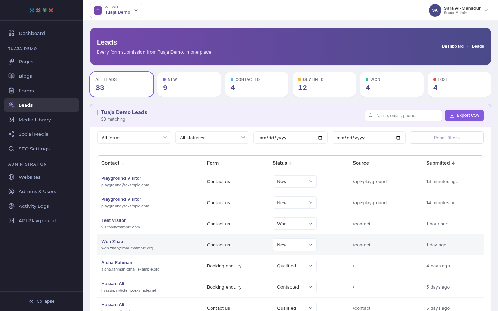
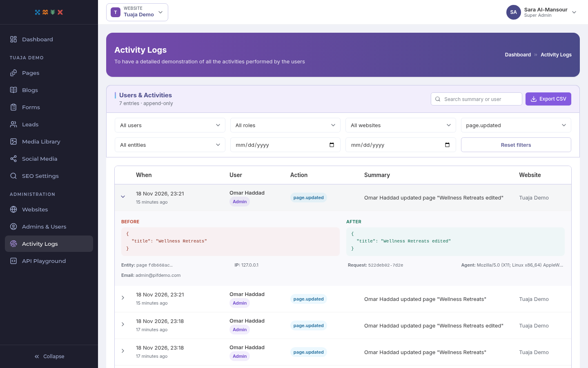
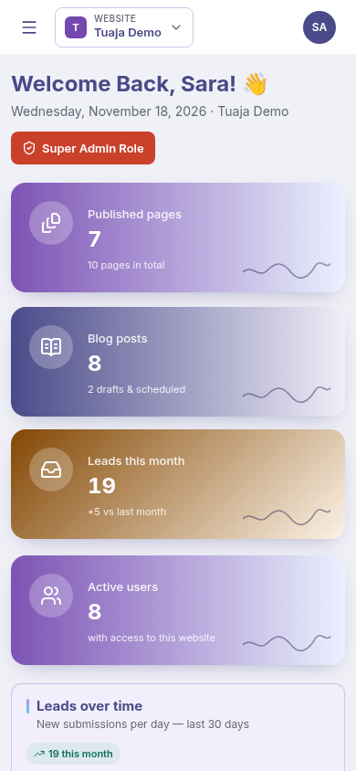
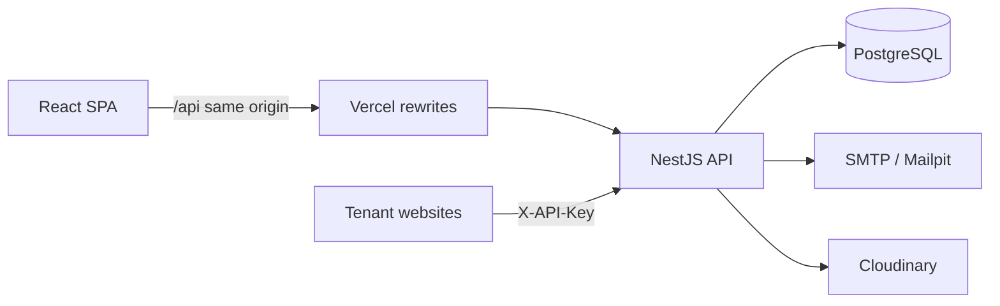

# PIF Admin Panel

[](https://github.com/RohabAmir/PIF-AdminPanel-MVP/actions/workflows/ci.yml)


A production-grade, **multi-tenant CMS admin panel**: one dashboard to manage the pages, typed content blocks, blogs, forms, leads, SEO, media and social links of **any number of websites** — with two-factor login, role-based access, per-website isolation, a public content API and a complete audit trail.


## Highlights

- 🔐 **Secure authentication** — password + emailed 6-digit OTP, forced password change on first login, forgot/reset by single-use link, account lockout, rotating refresh tokens with **theft (reuse) detection**, access token kept in memory only, cross-tab logout.
- 🧑‍🤝‍🧑 **RBAC** — Super Admin / Admin / Editor / Viewer, enforced by API guards and mirrored in the UI ([matrix](docs/RBAC.md)).
- 🏢 **Multi-tenancy** — shared schema with `siteId` everywhere, enforced centrally by a Prisma extension; create a new website from the UI and manage it instantly — zero code changes.
- 🧱 **CMS** — pages with drag-and-drop **typed sections** (hero, rich text, image & text, feature cards, stats, testimonials, FAQ, CTA, gallery) with live preview + JSON view; **Tiptap** blogs with categories, tags, scheduling and reading time; form builder; leads with notes, statuses and CSV export; media library; social links; global + per-page **SEO with Google preview**.
- 🌐 **Public content API** — API-key authenticated, CORS-open, cached; form submissions create leads (honeypot + rate limit). Try it in the built-in **API Playground** or the static `demo-site.html`.
- 📜 **Activity logs** — every mutating action with actor, role at the time, website, before/after diff, IP, user agent and request id; filters + CSV export; append-only.
- ✅ **Quality** — TypeScript strict, 27 backend unit + 65 backend e2e tests (real Postgres), 15 frontend tests, Playwright smoke test, ESLint/Prettier, Husky, CI/CD with GitHub Actions → Render + Vercel.

## Screenshots

| Sign in                              | Two-step verification            |
| ------------------------------------ | -------------------------------- |
|  |  |

| Page editor — typed sections, live preview       | Blog editor — Tiptap                             |
| ------------------------------------------------ | ------------------------------------------------ |
|  |  |

| Leads                                | Activity logs with diffs                             |
| ------------------------------------ | ---------------------------------------------------- |
|  |  |

| Users & roles                        | Mobile                                                                |
| ------------------------------------ | --------------------------------------------------------------------- |
|  |  |

## Demo logins

All demo accounts share the password **`Demo@12345`**. Each sign-in emails a one-time code (locally visible in Mailpit at http://localhost:8025; on the hosted demo it is shown on screen).

| Role        | Email                    | Websites             |
| ----------- | ------------------------ | -------------------- |
| Super Admin | `superadmin@pifdemo.com` | all                  |
| Admin       | `admin@pifdemo.com`      | Tuaja Demo, Dan Demo |
| Editor      | `editor@pifdemo.com`     | Tuaja Demo           |
| Viewer      | `viewer@pifdemo.com`     | Dan Demo             |

Public API demo keys: Tuaja Demo `pif_tuajadem_PublicDemoKey-TuajaDemo-2026` · Dan Demo `pif_dandemo1_PublicDemoKey-DanDemo-2026xx`.

## Architecture



Details: [ARCHITECTURE.md](docs/ARCHITECTURE.md) (request lifecycle, tenant isolation, auth sequence, ERD) · [RBAC.md](docs/RBAC.md) · [API.md](docs/API.md) (and Swagger at `/api/docs`) · [CI-CD-GUIDE.md](docs/CI-CD-GUIDE.md) · [DECISIONS.md](docs/DECISIONS.md) · [DESIGN-TOKENS.md](docs/DESIGN-TOKENS.md).

## Tech stack

| Layer              | Tools                                                                                                                                                                                                          |
| ------------------ | -------------------------------------------------------------------------------------------------------------------------------------------------------------------------------------------------------------- |
| Frontend           | React 18, TypeScript (strict), Vite 6, React Router 6 (data router), TanStack Query 5, Axios (refresh interceptor), React Hook Form + Zod, Tailwind CSS 3, Radix UI, Tiptap, Recharts, dnd-kit, Lucide, Sonner |
| Backend            | NestJS 11, Prisma 6, PostgreSQL 16, Passport-JWT, bcrypt, class-validator, Throttler, Helmet, Swagger, Nodemailer + Handlebars, Joi env validation, Pino, Terminus                                             |
| Testing            | Jest + Supertest (e2e on a real database), Vitest + Testing Library, Playwright                                                                                                                                |
| Tooling & delivery | ESLint, Prettier, Husky + lint-staged, GitHub Actions, Dependabot, Render (API + DB), Vercel (web)                                                                                                             |

## Run it locally

Prerequisites: **Node 20.19+** and either **Docker** or nothing else (a Docker-free fallback is included).

```bash
git clone https://github.com/RohabAmir/PIF-AdminPanel-MVP.git
cd PIF-AdminPanel-MVP
npm run setup                       # installs root, backend and frontend

# 1. Infrastructure: PostgreSQL 16 + Mailpit
npm run infra                       # docker compose up -d
#   …or without Docker (embedded Postgres 16 + Mailpit-compatible catcher), in a separate terminal:
#   npm run infra:local

# 2. Configuration
cp backend/.env.example backend/.env           # then set two random JWT secrets:
node -e "console.log(require('crypto').randomBytes(48).toString('base64url'))"
cp backend/.env.test.example backend/.env.test # only needed for the e2e tests
cp frontend/.env.example frontend/.env

# 3. Database
npm run db:setup                    # prisma migrate deploy + idempotent seed

# 4. Start API + web
npm run dev
```

|                     | URL                                  |
| ------------------- | ------------------------------------ |
| Admin panel         | http://localhost:5173                |
| API                 | http://localhost:3000/api            |
| Swagger             | http://localhost:3000/api/docs       |
| Mailpit inbox       | http://localhost:8025                |
| Demo tenant website | http://localhost:5173/demo-site.html |

### Quality commands

```bash
npm run lint && npm run typecheck && npm run test && npm run build   # both apps
npm --prefix backend run test:e2e                                     # API e2e (uses pif_admin_test)
npx playwright install chromium && npm run e2e                        # browser smoke test (stack running)
```

## Project structure

```
PIF-AdminPanel-MVP/
├── backend/            NestJS API — auth, users, sites, cms/*, public-api, audit, dashboard
│   ├── prisma/         schema, migrations, idempotent seed
│   └── test/           e2e suites (auth, users, RBAC & tenancy, CMS & public API)
├── frontend/           React app — auth/, site/, components/{ui,layout,cms}, pages/
├── e2e/                Playwright smoke test
├── docs/               architecture, RBAC, API, CI/CD guide, decisions, design tokens, screenshots
├── scripts/            timelog, Docker-free local infra
├── .github/workflows/  ci.yml, deploy.yml, keep-alive.yml
├── docker-compose.yml  render.yaml  frontend/vercel.json
└── TIME_REPORT.md      real build time per phase
```

---

Built by Rohab Amir. **Demo project — all data is fictional.** Logo, backgrounds and palette are reused from the original dashboard at the project owner's request. MIT licensed.
