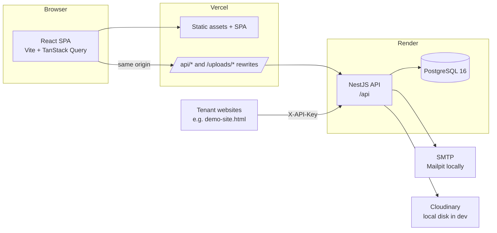
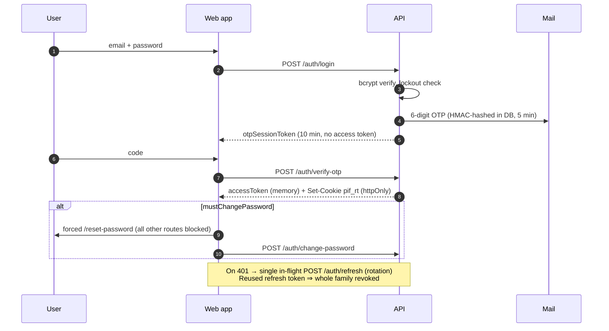

# Architecture

PIF Admin Panel is a **multi-tenant CMS admin panel**: one deployment manages any number of websites ("sites"). Each website's content is isolated, and each website consumes its published content through a read-only public API.



## Why these choices

| Concern  | Choice                                                                                            | Reason                                                                                                       |
| -------- | ------------------------------------------------------------------------------------------------- | ------------------------------------------------------------------------------------------------------------ |
| API      | NestJS 11 (modules, guards, interceptors, DI)                                                     | Clear boundaries per feature; guards make authorisation declarative and testable.                            |
| Data     | PostgreSQL 16 + Prisma 6                                                                          | Relational integrity for tenancy (FKs, cascades, `@@unique([siteId, slug])`), typed client, safe migrations. |
| Tenancy  | Shared DB, shared schema, `siteId` on every CMS table                                             | Simplest to operate; "any number of sites, zero code changes". Isolation is enforced centrally (see below).  |
| Auth     | Password → emailed OTP → JWT access (15 min, memory) + rotating refresh cookie (7 days, httpOnly) | Two factors; no tokens in `localStorage`; stolen refresh tokens are detected.                                |
| Frontend | React 18 + TS, React Router data router, TanStack Query, RHF + Zod, Tailwind + Radix              | Fast, accessible primitives styled with the original's exact tokens.                                         |
| Deploy   | Vercel (frontend) + Render (API + DB)                                                             | Free tiers, Git-driven; Vercel rewrites make the API same-origin, avoiding third-party cookie problems.      |

## Request lifecycle (API)

1. **Middleware** — request id (`X-Request-Id`), client IP, user agent stored in an `AsyncLocalStorage` request context; helmet, CORS (allow-list for the admin API, open for `/api/public/*`), cookie parser.
2. **Global guards (in order)**
   1. `ThrottlerGuard` — per-IP rate limit (stricter on auth routes; per-email limits inside the auth service).
   2. `JwtAuthGuard` — validates the Bearer token, **re-loads the user** (status + `tokenVersion`) so deactivation/sign-out-everywhere apply immediately. Skipped for `@Public()`.
   3. `PasswordChangeGuard` — while `mustChangePassword` is true only `@AllowDuringPasswordChange()` routes work.
   4. `PermissionsGuard` — `@RequirePermission()` (class + handler permissions combined).
   5. `SiteGuard` — for `@SiteScoped()` controllers: resolves `X-Site-Id`, verifies assignment (Super Admins: all sites), rejects inactive sites for non-super-admins.
3. **ValidationPipe** — DTO whitelist + `forbidNonWhitelisted`, field-level error details.
4. **Handler / service** — every CMS query goes through `prisma.forSite(siteId)`.
5. **AuditInterceptor** — after success, writes the activity log for `@Audit()` routes (before/after diff from service hints).
6. **AllExceptionsFilter** — every error becomes `{ statusCode, error, message, details?, requestId }`; no stack traces leak.

## Tenant isolation (defence in depth)

- **Guard:** `X-Site-Id` must be a site the caller is assigned to (403 otherwise — even for guessed ids).
- **Data layer:** `prisma.forSite(siteId)` is a Prisma client extension that injects `siteId` into the `where` of _every_ operation on tenant models — including unique lookups — and into every `create`. A record id from another site therefore yields **404**, never data. Updates can never move a row to another site.
- **Public API:** the site comes from the hashed API key, never from the request body or URL.
- **Tests:** `backend/test/rbac-tenancy.e2e-spec.ts` attempts cross-tenant reads, writes, deletes, reorders and section listing with guessed ids.

## Authentication flows



## Frontend structure

```
frontend/src
├── auth/        AuthProvider (session restore, cross-tab logout), route guards, PermissionGate
├── site/        SiteProvider (active website, X-Site-Id header, cache reset on switch)
├── lib/         api client (refresh interceptor), types, permissions mirror, utils
├── components/  ui/ (design-system kit), layout/ (sidebar, header, auth layout), cms/ (SEO editor, Tiptap, block editors)
├── hooks/       site-scoped queries/mutations, unsaved-changes blocker, public config
└── pages/       auth/, cms/, Dashboard, Users, Websites, Activity logs, Profile, API Playground
```

All CMS query keys start with `['site', siteId, …]`; switching sites removes those caches so nothing stale is ever shown.

## Data model (ERD)

```mermaid
erDiagram
  User ||--o{ UserSite : "assigned to"
  Site ||--o{ UserSite : has
  User ||--o{ OtpCode : ""
  User ||--o{ RefreshToken : ""
  User ||--o{ PasswordResetToken : ""
  Site ||--o{ Page : ""
  Page ||--o{ Section : ""
  Page ||--o{ Page : "parent/child"
  Site ||--o{ BlogPost : ""
  Site ||--o{ BlogCategory : ""
  BlogCategory ||--o{ BlogPost : ""
  User ||--o{ BlogPost : author
  Site ||--o{ Form : ""
  Form ||--o{ Lead : ""
  Site ||--o{ Lead : ""
  Lead ||--o{ LeadNote : ""
  Site ||--o{ SocialLink : ""
  Site ||--|| SeoSetting : ""
  Site ||--o{ MediaAsset : ""

  User { uuid id PK; string email UK; string name; enum role; enum status; bool mustChangePassword; datetime tempPasswordExpiresAt; int failedLoginAttempts; datetime lockedUntil; int tokenVersion }
  Site { uuid id PK; string name; string slug UK; string domain; string primaryColor; bool isActive; string apiKeyHash UK; string apiKeyPrefix }
  UserSite { uuid userId PK; uuid siteId PK }
  OtpCode { uuid id PK; string codeHash; datetime expiresAt; int attempts; int resendCount; datetime consumedAt }
  RefreshToken { uuid id PK; uuid familyId; string tokenHash UK; datetime expiresAt; datetime revokedAt; string revokeReason }
  PasswordResetToken { uuid id PK; string tokenHash UK; datetime expiresAt; datetime usedAt }
  Page { uuid id PK; uuid siteId FK; string slug "unique per site"; enum status; int order; json seo }
  Section { uuid id PK; uuid siteId FK; uuid pageId FK; enum type; json content; int order; bool isVisible }
  BlogPost { uuid id PK; uuid siteId FK; string slug "unique per site"; text content; enum status; datetime publishedAt; int readingTime; json seo }
  BlogCategory { uuid id PK; uuid siteId FK; string slug "unique per site" }
  Form { uuid id PK; uuid siteId FK; string key "unique per site"; json fields; bool isActive }
  Lead { uuid id PK; uuid siteId FK; uuid formId FK; json data; enum status; string sourcePage }
  LeadNote { uuid id PK; uuid siteId FK; uuid leadId FK; string body }
  SocialLink { uuid id PK; uuid siteId FK; enum platform "unique per site"; string url; int order }
  SeoSetting { uuid id PK; uuid siteId UK; string titleTemplate; string robotsTxt }
  MediaAsset { uuid id PK; uuid siteId FK; string url; string storage }
  ActivityLog { uuid id PK; datetime createdAt; uuid actorId; enum actorRole; uuid siteId; string action; string entityType; json before; json after; string requestId }
```

`ActivityLog` deliberately has **no foreign keys**: logs survive the deletion of users and websites and store a snapshot of the actor's name, email and role at the time.

## Media

`MediaStorage` abstracts the driver: `local` (dev, served from `/uploads`), `cloudinary` (prod). If Cloudinary is not configured in production the driver becomes `url`: uploads are disabled with a visible hint and images are added by URL, so the demo never breaks. Uploaded files are type-checked by **magic bytes** (JPEG/PNG/WebP/GIF only; SVG rejected to avoid stored XSS) and capped at 5 MB.

## Observability

Pino structured logs with request ids (pretty in development), secrets redacted (`authorization`, cookies, API keys). `GET /api/health` (Terminus) checks the database and is used by Render health checks and the deploy pipeline.
