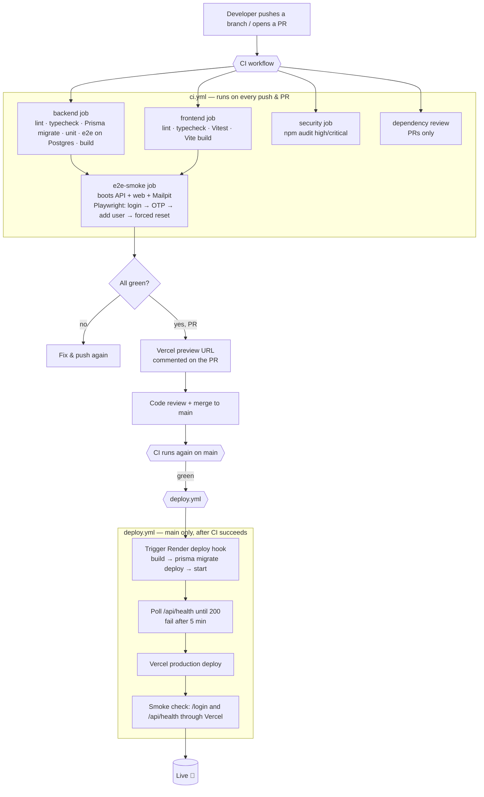

# CI/CD guide — how code gets from a laptop to production

This guide explains the pipeline in plain language so you can maintain it and explain it to a client.

## 1. The two ideas

- **CI — Continuous Integration.** Every time someone pushes code or opens a pull request, a robot (GitHub Actions) checks out the code on a clean machine, installs it, and runs every quality gate: linting, type checks, unit tests, end-to-end API tests against a real PostgreSQL database, a production build, a browser smoke test and a security audit. If anything fails, the change is marked ❌ and cannot be merged.
- **CD — Continuous Delivery/Deployment.** When a change lands on `main` **and CI is green**, a second workflow deploys it automatically: the API to Render, the web app to Vercel, then it checks that production is healthy.

Nobody deploys from their own machine, and nothing reaches production without passing the same tests.

## 2. The pipeline at a glance

## 3. What each job does and why

| Job                   | What it does                                                                                                                                                                                                                                                                                          | Why it matters                                                                                                                              |
| --------------------- | ----------------------------------------------------------------------------------------------------------------------------------------------------------------------------------------------------------------------------------------------------------------------------------------------------- | ------------------------------------------------------------------------------------------------------------------------------------------- |
| **backend**           | Starts a throw-away PostgreSQL 16, installs with `npm ci` (exact lockfile versions), runs ESLint and `tsc --noEmit`, applies migrations, runs 27 unit tests and 65 end-to-end API tests (auth, OTP, refresh-token theft detection, RBAC, tenant isolation, CMS, public API, audit logs), then builds. | Catches logic, security and data bugs before anyone sees them. The e2e tests prove that one client's website can never read another's data. |
| **frontend**          | Lint, type-check, Vitest component tests, production build; uploads the build as an artifact.                                                                                                                                                                                                         | Broken UI code or type errors never reach users.                                                                                            |
| **e2e-smoke**         | Runs the real app (API + built frontend + Mailpit email catcher) and drives Chrome with Playwright through the most important journey. Reads the OTP and the temporary password from the captured emails.                                                                                             | Proves the pieces work _together_, like a user would use them. On failure it uploads screenshots, traces and server logs.                   |
| **security**          | `npm audit` for production dependencies — fails on _high/critical_, warns on _moderate_.                                                                                                                                                                                                              | Known-vulnerable libraries are blocked.                                                                                                     |
| **dependency review** | On pull requests, flags newly added dependencies with known vulnerabilities.                                                                                                                                                                                                                          | Stops risky packages entering through a PR.                                                                                                 |

Runs on the same branch cancel each other (`concurrency`), so only the newest commit is tested. `actions/setup-node` caches npm downloads, so runs are fast.

## 4. Secrets and variables — what to create and where

**GitHub → repository → Settings → Secrets and variables → Actions**

| Name                     | Type     | Where to get it                                                                                                                                   |
| ------------------------ | -------- | ------------------------------------------------------------------------------------------------------------------------------------------------- |
| `RENDER_DEPLOY_HOOK_URL` | Secret   | Render → your web service (`pif-admin-api`) → Settings → **Deploy Hook** → copy URL.                                                              |
| `VERCEL_TOKEN`           | Secret   | Vercel → Account Settings → **Tokens** → Create (scope: your team).                                                                               |
| `VERCEL_ORG_ID`          | Secret   | Run `npx vercel link` inside `frontend/` once; copy `orgId` from `frontend/.vercel/project.json` (or Vercel → Team Settings → General → Team ID). |
| `VERCEL_PROJECT_ID`      | Secret   | Same file: `projectId` (or Vercel → Project → Settings → General → Project ID).                                                                   |
| `API_URL`                | Variable | The Render URL, e.g. `https://pif-admin-api.onrender.com` (health polling + keep-alive).                                                          |
| `APP_URL`                | Variable | The Vercel URL, e.g. `https://pif-admin-panel.vercel.app` (post-deploy check).                                                                    |

**Render (service → Environment)** — values for the keys listed in `render.yaml` that are marked `sync: false`: `FRONTEND_URL`, `API_PUBLIC_URL`, `CORS_ORIGINS` (all = the Vercel URL), SMTP settings (any SMTP provider, e.g. Brevo / Resend / Mailtrap), optional Cloudinary credentials. `JWT_*` secrets are generated by Render automatically; `DATABASE_URL` is wired from the blueprint database.

**Vercel** — no runtime env vars needed: the app calls `/api` on its own origin and `vercel.json` rewrites it to Render. Update the Render hostname in `frontend/vercel.json` if your service name differs.

Secrets are never printed in logs and never committed. `.env` files are git-ignored; `.env.example` files document every key.

## 5. How database migrations are applied safely

- Schema changes are written as **Prisma migrations** (SQL files committed under `backend/prisma/migrations`). CI applies them to a fresh database on every run, so a broken migration fails CI first.
- On Render, every deploy runs `prisma migrate deploy` **before** the new version starts (pre-deploy command; on the free plan it runs as part of the start command). It only applies migrations that have not run yet and never drops data on its own.
- Write migrations to be **backwards compatible** (add columns as nullable/with defaults first, remove old ones in a later release) so a rollback of the app code still works with the newer schema.
- `prisma migrate reset` is **never** used in production.

## 6. Rollbacks

- **Frontend (Vercel):** Project → Deployments → pick the previous good deployment → **⋯ → Promote to Production / Instant Rollback**. Takes seconds; no rebuild.
- **API (Render):** Service → **Events/Deploys** → choose an earlier successful deploy → **Rollback/Redeploy**. Alternatively `git revert` the bad commit and push — the pipeline redeploys the fixed version.
- **Database:** take a backup before risky migrations (Render dashboard → database → Backups on paid plans, or `pg_dump`). Prefer forward fixes (a new migration) over reverting schema.

## 7. Reading a failed run

1. GitHub → **Actions** → click the red run → the failing job → the red step. The last ~30 lines usually say exactly what failed (test name + expected/received).
2. Lint/type errors show file and line — fix locally with `npm run lint` / `npm run typecheck`.
3. For **e2e-smoke**, download the `playwright-report` artifact: it contains a screenshot, a step-by-step trace (open with `npx playwright show-trace trace.zip`) and the API/web server logs.
4. For **deploy**, the "Wait for /api/health" step prints each attempt; then check Render → service → Logs for the startup error (usually a missing environment variable — the API validates all env vars at boot and names the missing one).
5. Re-run with **Re-run failed jobs** only after you understand the failure (flaky network is rare but possible).

## 8. Branch protection (enable once on GitHub)

GitHub → Settings → **Branches** → Add rule for `main`:

- ✅ Require a pull request before merging (1 approval)
- ✅ Require status checks to pass: `Backend — lint, typecheck, unit, e2e, build`, `Frontend — lint, typecheck, vitest, build`, `E2E smoke (Playwright)`, `Dependency audit`
- ✅ Require branches to be up to date before merging
- ✅ Do not allow bypassing the above settings

## 9. Render free-tier caveats (and fallbacks)

- **Cold starts:** free web services sleep after ~15 minutes without traffic; the first request then takes **~30–60 s**. The optional `keep-alive.yml` workflow pings `/api/health` every 14 minutes to keep the demo warm (it only runs when the `API_URL` variable is set; disable it on a paid plan).
- **Free PostgreSQL expires after ~30 days.** Before that, either upgrade, or move to a free **Neon** or **Supabase** Postgres: create the database there, copy its connection string into Render's `DATABASE_URL` (add `?sslmode=require`), and redeploy — migrations and the seed run the same way (`npm run db:seed` from a Render shell, or locally pointing at the new URL).
- Free services have limited memory/CPU — fine for a demo, not for production traffic.
- Local file uploads would vanish on redeploy (ephemeral disk), which is why production uses Cloudinary or URL-only images.

## 10. Dependabot

`.github/dependabot.yml` opens weekly pull requests for npm packages (backend, frontend, root) and GitHub Actions. Each one runs the full CI, so updates are merged only when everything stays green.

## 11. How to explain this to the client (talking points)

- **Every change is tested automatically before it can go live** — more than 100 automated checks run on every update, including a robot that logs in and uses the app like a real person.
- **Releases are faster and routine** — merging an approved change ships it to production in minutes, with no manual steps that someone could forget.
- **Fewer bugs reach your users** — problems are caught on a copy of the system, not on your live website.
- **Security is checked continuously** — vulnerable libraries are blocked and dependencies are updated weekly through reviewed pull requests.
- **Every deploy is identical and repeatable** — the same scripted process runs every time, so "it worked on my machine" problems disappear.
- **Instant rollback** — if something unexpected happens, we can restore the previous version in seconds.
- **Every change is traceable** — each release is linked to a code review, a test report and an automatic preview link you can click before it goes live.
- **Quality gates protect the business** — the main branch cannot be changed without passing tests and a review.
